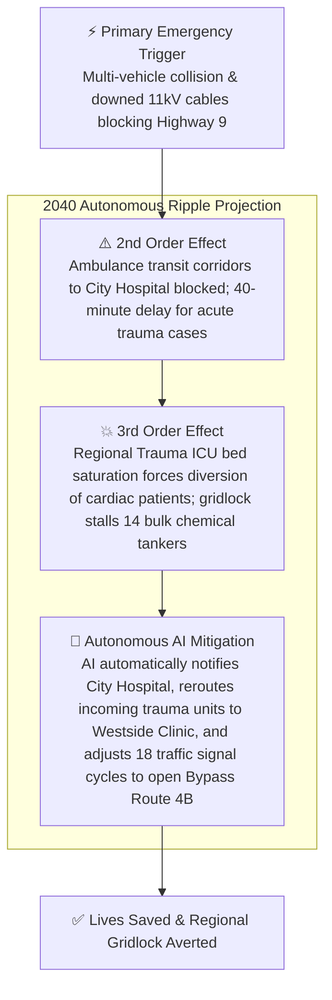
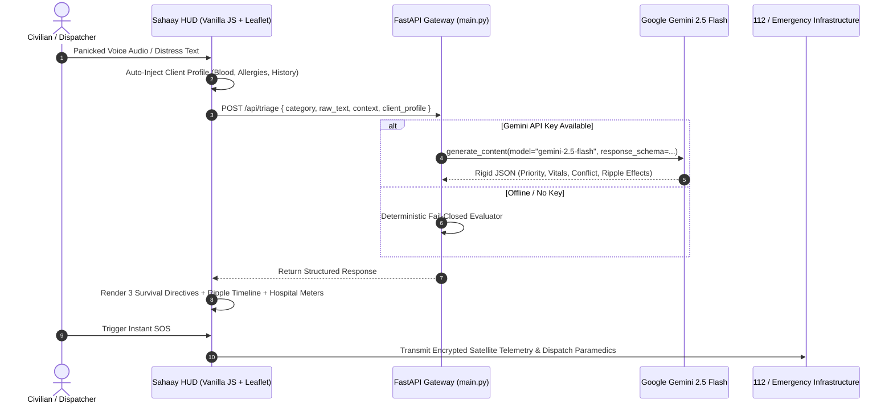

# 🌐 Sahaay: Universal Triage Bridge (2040 Edition)

> **Autonomous AI Emergency Automation Engine Powered by Google Gemini 2.5 Flash**  
> Converts chaotic, unstructured human intent and physical sensor telemetry into deterministic, life-saving dispatch manifests and predicts cascading multi-tier ripple effects.

---

## 🏆 Table of Contents
1. [Chosen Vertical](#-chosen-vertical)
2. [Approach and Logic](#-approach-and-logic)
3. [How the Solution Works](#-how-the-solution-works)
4. [The Killer Feature: Predictive Ripple Effect Engine](#-the-killer-feature-predictive-ripple-effect-engine)
5. [Map Automation & Live AI Radar](#-map-automation--live-ai-radar)
6. [System Architecture & Data Flow](#-system-architecture--data-flow)
7. [API Specification & Structured Schemas](#-api-specification--structured-schemas)
8. [Assumptions Made](#-assumptions-made)
9. [Quickstart & Running Locally](#-quickstart--running-locally)

---

## 🎯 Chosen Vertical
**Disaster Management, Autonomous Emergency Response, and Smart Urban Infrastructure.**

During catastrophic events (cardiac collapses, toxic chemical leaks, multi-vehicle highway pileups, flash floods), emergency 911/112 command centers face an overwhelming deluge of frantic, misspelled, incoherent civilian calls. At the same time, municipal sensors, SCADA telemetry, and hospital ERs operate in disconnected data silos.

**Sahaay** acts as a universal bridge from the year 2040: it takes chaotic human distress streams, correlates them against authoritative physical telemetry and personal medical profiles, extracts atomic facts, and executes automated mitigations before cascading crises overwhelm regional infrastructure.

---

## 🧠 Approach and Logic
Sahaay adheres to five fundamental design and engineering principles:

1. **Deterministic Structured Outputs (Zero Hallucination)**:
   Conversational chat models are lethal in emergency triage. Sahaay forces Gemini 2.5 Flash into rigid Pydantic JSON schemas via `google-genai` SDK `response_schema` enforcement.

2. **Client Profile Auto-Injection (Allergy & Medical Interlock)**:
   The user's clinical profile (blood type, chronic conditions, and lethal drug contraindications such as Penicillin anaphylaxis) is stored in local neural cache and automatically injected into every emergency payload. If emergency workers or callers propose contraindicated interventions, the engine triggers an instant red interlock.

3. **Conflict Detection & Rumor Debunking**:
   Panicked callers frequently propagate rumors (e.g. claiming a dam collapsed). Sahaay's Climate Core compares civilian claims against authoritative SCADA gauge feeds and PWD structural sensors. If a contradiction is detected, `conflict_detected=true` is flagged with verified opposing facts.

4. **Fail-Closed High Availability Architecture**:
   If internet connectivity or the Gemini API is temporarily disrupted, Sahaay immediately shifts to an internal, deterministic fail-closed evaluator with built-in predictive ripple matrices. The system never crashes or hangs.

5. **Asymmetrical Dual-Audience Synthesis**:
   - **Civilian View**: Exactly 3 concise, imperative, non-jargon life-saving stabilization directives.
   - **Command Dispatch View**: Full auditable evidence ledger with source citations, priority classifications (P1/P2/P3), and telemetry coordinates.

---

## ⚡ How the Solution Works
1. **Multimodal Ingestion**:
   - Users provide unstructured inputs via voice recordings (simulated or Web Speech API), photos (camera capture preview), or raw panicked text.
   - One-click **GPS Lock** triangulates satellite coordinates.
2. **Unified Intelligence API (`POST /api/triage`)**:
   - The payload sends `category`, `raw_text`, `context_data`, and the auto-injected `client_profile`.
   - FastAPI parses the payload and dispatches it to Gemini 2.5 Flash with domain-tailored system instructions.
3. **Structured Verification & Ripple Prediction**:
   - Gemini structures the emergency, extracts clinical vitals / physical obstacles, verifies evidence, and predicts 2nd and 3rd order cascading impacts.
4. **Actionable Autonomous Dispatch**:
   - Results populate the interactive dashboard with deep-linked Google Maps navigation, nearby hospital capacity meters, and live CAD dispatch manifests.

---

## 🌊 The Killer Feature: Predictive Ripple Effect Engine
Traditional triage systems only address the immediate symptom: *"There is an accident on Highway 9."*

**Sahaay's Predictive Ripple Effect Engine** projects the second- and third-order consequences across municipal and regional systems, autonomously initiating preemptive mitigations before bottlenecks materialize:



### Real-World Scenarios Handled:
- **Medical Triage**: Acute cardiac collapse -> ICU saturation alert -> Pre-books Bed #4 at Sacred Heart & activates cath lab standby at Ruby Hall.
- **Traffic Triage**: Highway 9 severed -> Paramedic route delayed by 40 min -> Pre-diverts ambulances to Westside Clinic & opens automated counterflow lane.
- **Climate / Disaster Triage**: Dam failure rumor vs. closed SCADA gates -> Stampede risk on Low Causeway -> Broadcasts emergency SMS debunk to 45,000 localized cell phones.
- **Custom / Industrial Hazard**: Chemical vapor leak -> Downwind rail line exposure -> Halts Express Train #12104 at Signal Box 9 & pre-dispatches 80 oxygen cylinders.

---

## 🛰️ Map Automation & Live AI Radar
Built using Leaflet.js via CDN (zero heavy build dependencies):
1. **Futuristic Tile Architecture**:
   - Automatically renders CartoDB Dark Matter tiles in "Neon Cyber Dark" mode and CartoDB Voyager tiles in "Sleek Holographic Light" mode.
2. **Pulsing Red Alert Incidents**:
   - Real-time animated CSS ripple markers (`.alert-radar-pulse`) pinpointing critical multi-car collisions, flood surges, and toxic vapor containment perimeters.
3. **Interactive Hospital Directory & Capacity Telemetry**:
   - Green pulsing medical crosses represent verified emergency centers.
   - Clicking a hospital marker opens a futuristic HUD modal featuring high-resolution imagery (Unsplash CDN), bed occupancy metrics (e.g., *82% Capacity | 4 ICU Beds Available*), and AI-decoded safety briefs.
4. **Google Maps Satellite Deep-Linking**:
   - Uses `navigator.geolocation` to compute live turn-by-turn routes directly into Google Maps for both civilian hospitals and police command centers.
5. **One-Click Automated SOS Dispatch**:
   - Simulates packaging GPS telemetry, legal identity, blood type, and allergy interlocks directly to the National 112 Command with an interactive terminal log.

---

## 🏗️ System Architecture & Data Flow



---

## 📋 API Specification & Structured Schemas

### Endpoint: `POST /api/triage`
**Request Body**:
```json
{
  "category": "medical",
  "raw_text": "Father collapsed clutching chest, sweating cold, HR 134, BP 82/50, SpO2 86%!",
  "context_data": "Prescription: Penicillin allergy, prior coronary stent.",
  "client_profile": {
    "name": "Ramesh Verma",
    "blood_type": "O+",
    "emergency_contact": "+91-98220-44911",
    "allergies": "SEVERE ANAPHYLACTIC SHOCK TO PENICILLIN & AMOXICILLIN",
    "medical_history": "Prior LAD stent (2020), Atorvastatin 40mg."
  }
}
```

**Unified Response (Medical Example)**:
```json
{
  "category": "medical",
  "triage_priority": "P1_CRITICAL",
  "suspected_condition": "Acute Cardiogenic Shock & Anaphylaxis Vulnerability",
  "extracted_vitals": [
    "Heart Rate: 134 bpm (Severe Tachycardia)",
    "Blood Pressure: 82/50 mmHg (Cardiogenic Hypotension)",
    "SpO2: 86% (Critical Hypoxia)"
  ],
  "required_antidotes": [
    "Sublingual Nitroglycerin / IV Calcium Gluconate",
    "Non-Beta-Lactam Protocol (Azithromycin standby)",
    "High-Flow Supplemental Oxygen (15 L/min)"
  ],
  "civilian_instructions": [
    "Position patient elevated upright at a 45-degree angle; do NOT lay patient flat.",
    "Loosen tight collar and ensure unobstructed airflow.",
    "Keep all medication boxes ready at the front threshold for incoming ALS paramedics."
  ],
  "conflict_detected": true,
  "conflict_details": "CRITICAL DRUG ALLERGY FLAGGED VIA PROFILE INJECTION: Patient has recorded severe anaphylactic shock to Penicillin. Beta-lactam antibiotics must be withheld.",
  "evidence_ledger": [
    { "source": "Caller Voice Audio Stream", "claim": "Chest pain, diaphoresis, gasping", "confidence": "HIGH" },
    { "source": "Home Telemetry Monitor", "claim": "HR 134, BP 82/50, SpO2 86%", "confidence": "HIGH" }
  ],
  "ripple_effect_prediction": {
    "second_order_effect": "Sacred Heart Hospital Trauma ICU is at 82% capacity; cardiac intake will push trauma unit beyond safety margins in 30 minutes.",
    "third_order_effect": "Regional ambulance diversion will delay peripheral medical calls in Sector 14 by 22%.",
    "automated_mitigation": "AI pre-booked ICU Bed #4 at Sacred Heart and alerted Ruby Hall emergency team to accept peripheral diversions.",
    "cascading_risk_level": "CRITICAL"
  }
}
```

---

## 📌 Assumptions Made
1. **Network Independence**: The frontend is completely functional offline and standalone; if the Python backend is stopped, `app.js` runs a local deterministic engine with full ripple prediction.
2. **WCAG AAA Accessibility**: The color palette uses high-contrast text ratios, semantic HTML5, explicit ARIA roles (`role="tab"`, `role="alert"`, `aria-live="polite"`), and a top keyboard skip link.
3. **Data Privacy**: Client profile data is stored exclusively in `localStorage` on the user's device and is never persisted into an external database without explicit user transmission.
4. **Emergency Deep-Linking**: When satellite coordinates are available, direct URLs automatically calculate origin-to-destination directions using standard Google Maps query schemas.

---

## 🚀 Quickstart & Running Locally

### 1. Requirements
- Python 3.9+
- Optional: `GEMINI_API_KEY` (Sahaay runs gracefully with full simulated output if omitted)

### 2. Install Dependencies
```bash
pip install fastapi uvicorn google-genai pydantic
```

### 3. Launch Backend
```bash
export GEMINI_API_KEY="your-gemini-api-key-here"
python3 main.py
```
*Backend runs on `http://localhost:8000` with Swagger docs at `http://localhost:8000/docs`.*

### 4. Launch Frontend
Open `index.html` in any modern web browser or serve via Python/Node:
```bash
python3 -m http.server 8080
```
Visit `http://localhost:8080` to experience the 2040 Incident Command Console!

---

## 📂 Project Structure (Strict 5-File Architecture)
```
├── main.py        # FastAPI Backend + Gemini 2.5 Flash SDK + Structured Schemas
├── index.html     # HTML5 Semantic Console + Leaflet CDN + Glassmorphic Layout
├── styles.css     # Holographic Pastel Cyber Theme + 3D Pure CSS Background
├── app.js         # Leaflet Map Engine + Ripple Engine + SOS + Multilingual i18n
├── README.md      # Comprehensive Architecture Documentation
└── .gitignore     # Strict exclusion of virtualenvs, .env, and caches
```

*Architected for Hackathon Excellence // Sahaay 2040.*
